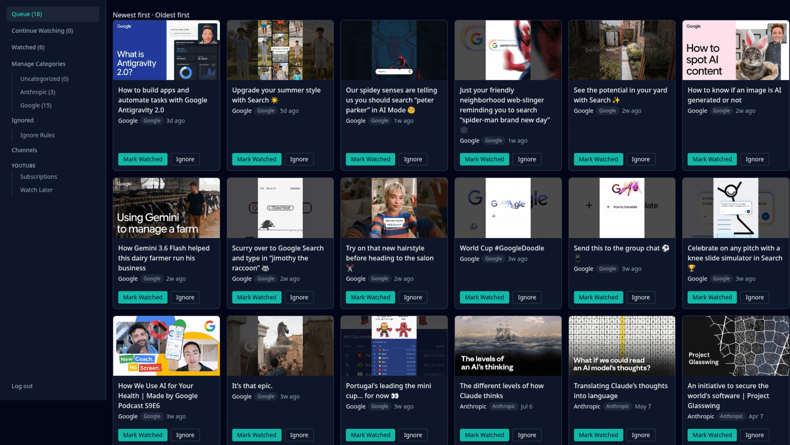

# Tubeshelf

[](https://github.com/jonrus/Tubeshelf/actions/workflows/pr.yml)

[](https://github.com/jonrus/Tubeshelf/releases/latest)

A self-hosted YouTube subscription tracker: a queue-based alternative to the YouTube
Subscriptions page, with per-channel categories, watch-status tracking, and keyword-based
noise filtering.



## Features

- Subscribe to channels by `@handle`, channel URL, or channel ID, via RSS — no YouTube Data
  API key required
- Organize channels into free-text categories, and filter every view by category
- Unwatched / Watching / Watched tracking, with Queue, Continue Watching, and Watched
  history views
- Keyword-based Ignore rules that auto-filter noise (e.g. `#shorts`), plus manual ignore
  with an Ignored view to review and undo
- Newest-first or oldest-first sorting, per category
- Optional video duration display via a YouTube Data API key

## Why Tubeshelf?

The YouTube Subscriptions page is busy and can't be split by the kind of video you're in the
mood for. Tubeshelf gives you a queue per category (podcasts, tutorials, let's plays, ...)
so you can see at a glance what's unwatched.

Videos open on youtube.com itself rather than an embedded player, so your browser's
ad-blocking and SponsorBlock keep working normally.

## Quick start

Tubeshelf runs as a single container. Grab the example
[`docker-compose.yml`](docker-compose.yml) and start it:

```
curl -O https://raw.githubusercontent.com/jonrus/Tubeshelf/main/docker-compose.yml
docker compose up -d
docker compose logs tubeshelf   # shows the generated admin password
```

Open [http://localhost:3000](http://localhost:3000) and log in as `admin`. Data is stored
in `./data` next to the compose file. If you'll browse to the app from any other address
(a LAN IP, a domain behind a reverse proxy), set `TRUSTED_ORIGINS` to match — see below.

See [docs/DEPLOYMENT.md](docs/DEPLOYMENT.md) for `TRUSTED_ORIGINS` and other configuration,
file ownership (`PUID`/`PGID`), backups, updating, and reverse-proxy notes.

## Documentation

- [docs/DEPLOYMENT.md](docs/DEPLOYMENT.md) — running and operating Tubeshelf
- [docs/app_idea.md](docs/app_idea.md) — the full product spec

## Development

Tubeshelf is built with Bun, Hono, HTMX, and SQLite. Outside pull requests aren't being
accepted yet, but the repo is set up so a fork is workable — see
[CONTRIBUTING.md](CONTRIBUTING.md) for the devcontainer setup, checks, and the
spec-driven workflow.

## AI assistance

Tubeshelf is developed with Claude Code, under human direction. Every change starts from a
written spec in [docs/specs/](docs/specs/), which is committed alongside the code.

## License

GPLv3 — see [LICENSE](LICENSE).
